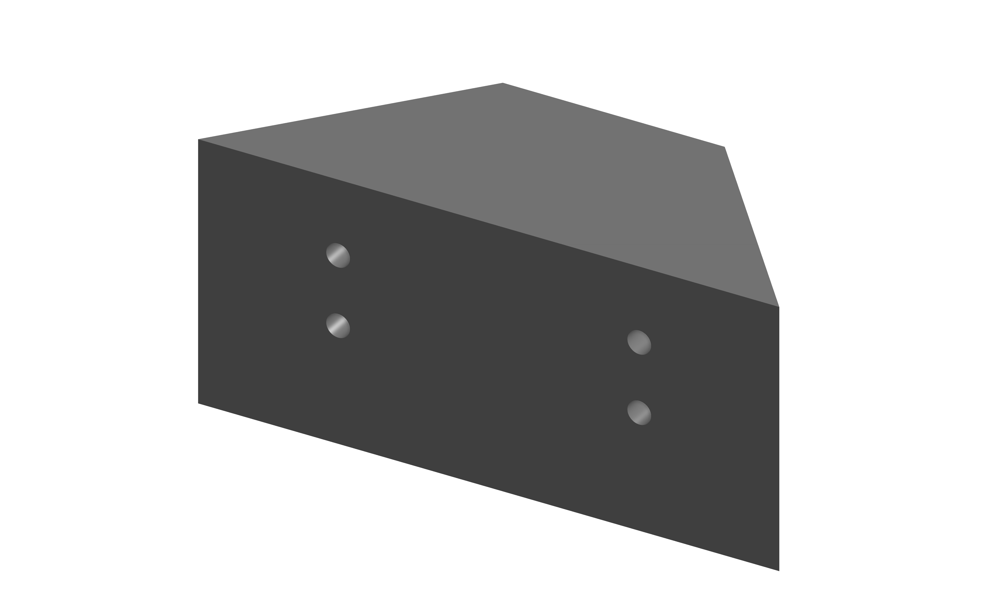
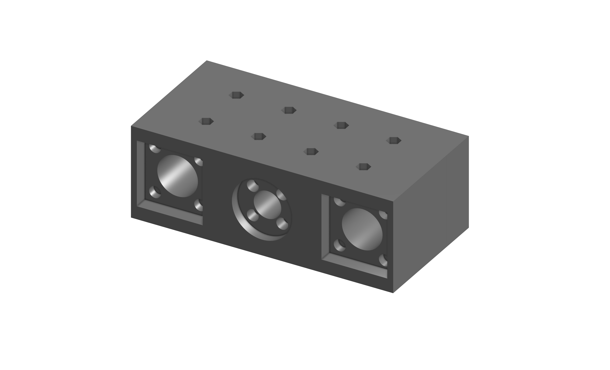
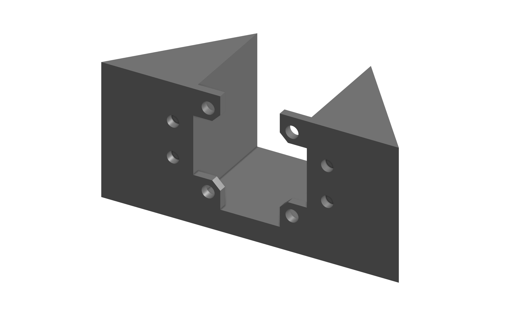

# Automatisierter Linearschlitten (Anycubic PoC)

&gt; **Proof of Concept für ein automatisiertes Meerwasser-Labor** — Ein linearer Verfahrschlitten, gebaut aus wiederverwerteten Komponenten eines **Anycubic 3D-Druckers**, zur präzisen Bewegung und Positionierung von Dosierköpfen.

---

## Inhaltsverzeichnis
- [Über das Projekt](#über-das-projekt)
- [Highlights &amp; Specs](#highlights--specs)
- [Hardware &amp; Konstruktion](#hardware--konstruktion)
- [3D-Druck &amp; CAD-Komponenten](#3d-druck--cad-komponenten)
- [Bildergalerie](#bildergalerie)
- [Repository-Struktur](#repository-struktur)
- [Autor](#autor)

---

## Über das Projekt

Dieses Projekt dient als **Proof of Concept (PoC)** für ein geplantes, automatisiertes Meerwasser-Analyse- und Dosierlabor.

Um Testflüssigkeiten oder Dosiereinheiten präzise über verschiedenen Wasserproben zu positionieren, wurde aus Schlachteilen eines **Anycubic 3D-Druckers** (Schrittmotor, Führungsschienen, Zahnriemen und Endstopp) ein robuster Linearschlitten aufgebaut.

---

## Highlights &amp; Specs

- **Recycled Hardware:** Komponenten aus einem Schlachteile-3D-Drucker von Anycubic (Nema-Schrittmotor, Führungsschienen, Riemenscheiben, Zahnriemen).
- **Automatisierte Umkehrlogik:** Taster-gesteuerte Richtungsumkehr für präzises Anfahren von Zielpositionen.
- **Präzise Dosierung:** Mechanische Grundlage für das automatische Ansteuern von Messbehältern im Meerwasser-Lab.
- **C++ Firmware:** Integrierte Firmware im Ordner `Linearschlitten_Code` zur Auswertung des Endstopps und Ansteuerung des Motortreibers.
- **Fokus auf CAD &amp; Hardware:** Das Repository enthält alle 3D-Konstruktionsdateien (`.step` / `.stl`), Vorschau-Bilder sowie ein Demonstrations-Video (`Linearschlitten_Video.mp4`).

---

## Hardware &amp; Konstruktion

1. **Linearführung &amp; Antrieb:**
   Führungsschienen, Nema-Schrittmotor, Riemenscheiben und Zahnriemen aus einem Anycubic 3D-Drucker bilden das mechanische Gerüst für die präzise Schlittenbewegung.
2. **Taster-Umkehrlogik:**
   - **Start &amp; Anfahrt:** Der Schlitten startet die Fahrt in Richtung des physischen Endstopps (Taster).
   - **Kollisions-Erkennung &amp; Umkehr:** Sobald der Taster berührt und ausgelöst wird, registriert der Controller die Endposition, kehrt die Drehrichtung um und fährt den Schlitten für eine exakt definierte Zeitspanne in die entgegengesetzte Richtung zurück.

---

## 3D-Druck &amp; CAD-Komponenten

Alle gefertigten Bauteile stehen sowohl im druckfertigen **STL-Format** als auch als bearbeitbare **STEP-Datei** bereit:

| Bauteil | Vorschau | STL-Datei | STEP-Datei |
| :--- | :--- | :--- | :--- |
| **Linearschlitten Teil** | `Linearschlitten_Teil.png` | `Linearschlitten_Teil.stl` | `Linearschlitten_Teil.step` |
| **Linearschlitten Kopf** | `Linearschlitten_Teil_Kopf.png` | `Linearschlitten_Teil_Kopf.stl` | `Linearschlitten_Teil_Kopf.step` |
| **Linearschlitten Motor** | `Linearschlitten_Teil_Motor.png` | `Linearschlitten_Teil_Motor.stl` | `Linearschlitten_Teil_Motor.step` |

---

## Bildergalerie


*CAD-Render des Führungsschlittens.*


*CAD-Modell der Kopf-Halterung.*


*CAD-Modell der Schrittmotor-Halterung.*

---

## Repository-Struktur

```text
├── Linearschlitten_Code/
├── Linearschlitten_Teil.png / .step / .stl
├── Linearschlitten_Teil_Kopf.png / .step / .stl
├── Linearschlitten_Teil_Motor.png / .step / .stl
├── Linearschlitten_Video.mp4
└── ReadMe.md

```

---

## Autor

**Daniel Fast** ([@Minielel](https://www.google.com/url?sa=E&amp;q=https%3A%2F%2Fgithub.com%2FMinielel))

* **Portfolio:** [daniel-fast.de](https://www.google.com/url?sa=E&amp;q=https%3A%2F%2Fwww.daniel-fast.de)
